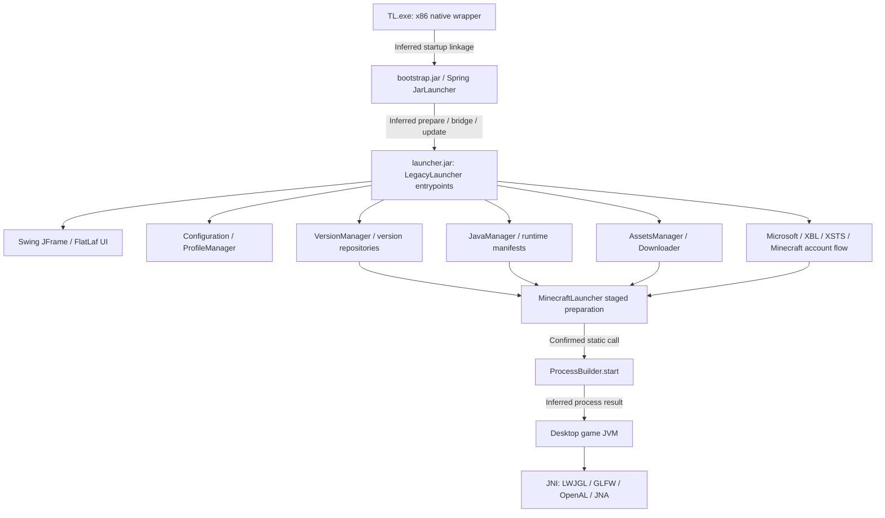
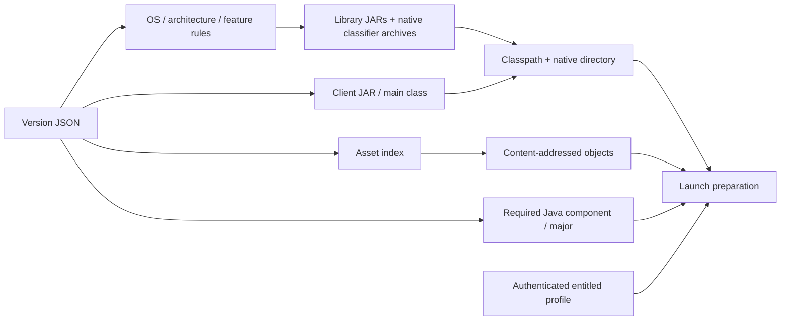

# Architecture

Research date: 2026-10-17 (America/Chicago). Static evidence only unless explicitly marked historical.

The following map combines confirmed structural/static-call evidence with inferred edges explicitly labeled. It is not an observed execution trace. [E02/E03/E05/E06]

**Confirmed:** `TL.exe` contains Launch4j and javaw strings and calls CreateProcessA in `FUN_00405126`, call site `0x40524e`. `tl.args` points to `launcher/launcher.jar`, `launcher/libraries` and `tl.properties`. The exact native-wrapper → bootstrap argument linkage has not been traced end to end. [E05/E06]

**Confirmed:** bootstrap manifest selects `org.springframework.boot.loader.JarLauncher` and `net.legacylauncher.bootstrap.BootstrapStarter`. Launcher metadata selects `LegacyLauncherEntrypoint` and bridged entry. `LegacyLauncherFrame` extends Swing JFrame; FlatLaf is packaged. [E02/E03]

| Subsystem | Confirmed static evidence | Remaining limit |
|---|---|---|
| Initialization | Launcher entry metadata; MinecraftLauncher.collectInfo | Full lifecycle branches untraced |
| Configuration | Configuration, SimpleConfiguration, AbstractConfiguration; preferences keys only inventoried | Exact setting precedence and rollback untraced |
| Profiles/accounts | ProfileManager.loadProfiles/saveProfiles uses Gson, temp output and Files.move; migration of launcher_profiles.json | Crash durability and storage protection unknown |
| Version selection | VersionManager.getVersionSyncInfo; resolveCompleteVersion; Official/Extra/Local lists | All mirrors and custom versions untested |
| Runtime discovery | JavaManager configuration, JavaRuntimeLocal/remote fetcher/installers | Actual selected path not captured live |
| Downloads | downloadResources queues runtime/version/assets; checks abort/error state | Retry/cancellation behavior not exhaustively traced |
| Game process | constructProcess → launchMinecraft → JavaProcessLauncher/ProcessBuilder.start | No process launched by this investigation |
| Error/exit control | onJavaProcessEnded, onJavaProcessError, killProcess, postLaunch methods | User-facing behavior and shutdown race handling untested |
| Updates | Nested bootstrap prepare/download/start/self-update surfaces, signed-stream/checksum types | Verification/trust/rollback policy unknown; type names alone are insufficient |

## Dependency graph and transferable boundary

**Confirmed:** these generic installation contracts are represented in method calls and selected version data. Swing branding, account-provider UI, launcher self-updater, settings presentation and bootstrap IPC are launcher-specific. **Inferred:** independent metadata resolution, hashing/caching and repair behavior can inform LegacyForge. Desktop subprocess/native-window behavior requires adaptation to LegacyForge's existing JNI/GLFW/Mesa path. [E03/E04/E07]

## Continuation findings

The original installer1.159.2 and bootstrap 1.32.2 are now directly inspected [E11/E13]. Native wrapper resource strings name launcher/bootstrap.jar and its restart/JRE configuration, resolving the prior declared-linkage gap; actual execution remains BLOCKED. UPDATE-AND-RECOVERY adds exact signed-path/checksum/persistence branches; LOADER-RESOLUTION adds original-build inheritance/Forge-family behavior; NATIVE-DEPENDENCIES records 291 native observations and existing shim limitations. Read the maps as structural/static relationships, not captured process/network traces.
