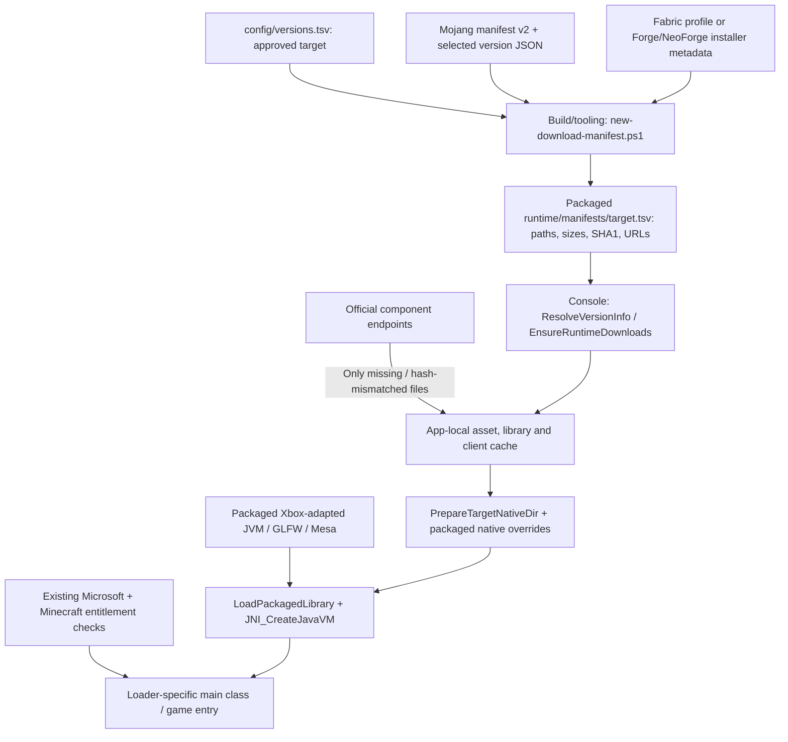

# Version downloads: from Legacy Launcher to LegacyForge

Research date: 2026-10-17 (America/Chicago). Static evidence only unless explicitly marked historical.

The transferable behavior is “resolve a version into a verified installation plan.” LegacyForge already does much of it. Porting the desktop executable, downloaded Windows JVM or Windows GLFW does not supply the Xbox runtime adaptation. [E03/E07/E08]

## Existing path at the approved commit

**Confirmed [E07]:** LegacyForge prepares approved targets at build/tooling time and consumes packaged download manifests on the console. This differs from assuming that it resolves every arbitrary new Mojang version live at runtime.

| Legacy Launcher behavior | LegacyForge equivalent already present | What needs attention |
|---|---|---|
| Fetch available versions | Build script queries official version_manifest_v2.json, finds exact ID and follows version.url | Exposing all manifest IDs in UI must not imply runtime support |
| Version JSON/client | Build script records JSON and downloads.client URL/hash/size as TSV entries | Preserve exact source metadata identity and receipts |
| Select libraries | Add-MinecraftLibraries / Test-LibraryAllowed | Ordered Windows/x64 handling exists; os.version fails closed; features/conditional args need explicit contract |
| Assets | Add-Assets records index and hash-addressed objects | Reuse content-addressed caching and verify completion |
| Download/repair | EnsureRuntimeDownloads checks SHA1, bounds workers 1–8, retries .download files, rejects mismatch, moves verified result | Add structured repair/install receipts; do not rewrite existing pipeline |
| Java choice | ResolveJavaRuntimeInfo selects current/java21/java17/legacy (jre/jre21/jre17/jre8) and versioned filesystem/ZIPFS patches | Do not replace Xbox runtime with downloaded Mojang desktop java.exe |
| Native preparation | PrepareTargetNativeDir extracts selected LWJGL/JNA DLLs and overlays packaged GLFW | File presence is not ABI/graphics compatibility; validate exact native versions |
| Classpath/main | CollectManifestLibraryJars; loader finalizers and classpath hooks | Keep loader-specific processors, module options and main classes |
| Startup | PreloadJvm + RunEmbeddedMinecraft load packaged modules and invoke JNI_CreateJavaVM | No desktop ProcessBuilder/java.exe transplant; verify requested JNI version for each runtime |
| Accounts/ownership | Existing OAuth device flow → XBL → XSTS → Minecraft → entitlement → profile | Preserve protections and token redaction unchanged |

Exact source anchors: [scripts/new-download-manifest.ps1:547](https://github.com/AlgorHome/LegacyForge/blob/d1453434ceefe73bef5aff497194e09f39dde7e1/scripts/new-download-manifest.ps1#L547), [scripts/new-download-manifest.ps1:155](https://github.com/AlgorHome/LegacyForge/blob/d1453434ceefe73bef5aff497194e09f39dde7e1/scripts/new-download-manifest.ps1#L155), [scripts/new-download-manifest.ps1:534](https://github.com/AlgorHome/LegacyForge/blob/d1453434ceefe73bef5aff497194e09f39dde7e1/scripts/new-download-manifest.ps1#L534), [MC.Xbox/launch/runtime_manager.cpp:770](https://github.com/AlgorHome/LegacyForge/blob/d1453434ceefe73bef5aff497194e09f39dde7e1/MC.Xbox/launch/runtime_manager.cpp#L770), [MC.Xbox/launch/runtime_manager.cpp:1079](https://github.com/AlgorHome/LegacyForge/blob/d1453434ceefe73bef5aff497194e09f39dde7e1/MC.Xbox/launch/runtime_manager.cpp#L1079), [MC.Xbox/launch/runtime_manager.cpp:1166](https://github.com/AlgorHome/LegacyForge/blob/d1453434ceefe73bef5aff497194e09f39dde7e1/MC.Xbox/launch/runtime_manager.cpp#L1166), [MC.Xbox/launch/runtime_manager.cpp:1310](https://github.com/AlgorHome/LegacyForge/blob/d1453434ceefe73bef5aff497194e09f39dde7e1/MC.Xbox/launch/runtime_manager.cpp#L1310), [MC.Xbox/launch/minecraft_launch.cpp:663](https://github.com/AlgorHome/LegacyForge/blob/d1453434ceefe73bef5aff497194e09f39dde7e1/MC.Xbox/launch/minecraft_launch.cpp#L663), [MC.Xbox/launch/minecraft_launch.cpp:1335](https://github.com/AlgorHome/LegacyForge/blob/d1453434ceefe73bef5aff497194e09f39dde7e1/MC.Xbox/launch/minecraft_launch.cpp#L1335).

## What happens for 1.21.11

**Confirmed:** the approved `config/versions.tsv` already lists experimental 1.21.11 targets: Fabric 0.19.5, Forge 61.2.1 and NeoForge 21.11.45, all assigned java21. This is a catalog/support declaration, not proof each combination runs on Xbox. The examined Legacy Launcher installation supplies vanilla 1.21.11 evidence; it does not validate those loader combinations. [E04/E07]

**Proposed independent workflow:** select one catalog target, generate/review its exact dependency manifest, package the compatible runtime/native bridge, let the console download only missing/mismatched client/library/asset files, prepare loader/native state, verify runtime readiness, retain entitlement/profile checks, then invoke the existing embedded JVM entry path. Gate support claims per version + loader + JVM + native/graphics combination.

**Confirmed:** the script fetches Fabric profile JSON from `https://meta.fabricmc.net/v2/versions/loader/<minecraft>/<loader>/profile/json`. Forge metadata/artifacts come through `maven.minecraftforge.net`, NeoForge through `maven.neoforged.net/releases`; the script reads installer/profile data and provider code handles client preparation. These are LegacyForge source observations, not recovered Legacy Launcher behavior or executed installers. [E07]

## If a live version picker is desired later

**Proposed:** keep “available upstream,” “downloaded,” and “validated for Xbox” separate. An independently written runtime resolver could fetch an official catalog and exact JSON, evaluate inheritance/rules/features, derive a bounded plan, verify metadata/hash/size, then reuse EnsureRuntimeDownloads. Approve a platform/runtime profile before offering Play. Use explicit errors for unsupported rules or loader processors; never silently flatten conditional values. Adding live arbitrary-version support is separate engineering work and was not implemented during Phase 6A.

Portable content contracts: JSON resolution, Maven paths, hash-addressed asset caching, size/hash repair and deterministic classpaths. Platform work: packaged JVM API/JIT behavior, native loading, GLFW/CoreWindow, Mesa graphics, input/audio, filesystem patches and lifecycle. Download success establishes installation state; hardware runtime evidence establishes gameplay readiness.

## Continuation: direct archived-build confirmation

The exact installer now yields launcher 1.159.2 and bootstrap 1.32.2, separately hash-bound from the installed updates. The archived launcher directly uses Mojang catalog→extra/official profile→inheritance→library/runtime/download→external Java process paths. Its Forge-family mod-list preparation and extra-version profiles are documented in LOADER-RESOLUTION. LegacyForge's full56-row catalog remains intact; use its existing approved manifest/downloader/embedded-host path and verify each exact runtime tuple. Static extraction does not turn later Windows downloads into Xbox-compatible binaries.

## Verified metadata example for a Fabric target [E17]

The public [Fabric profile endpoint](https://meta.fabricmc.net/v2/versions/loader/1.21.11/0.19.5/profile/json) returned ID `fabric-loader-0.19.5-1.21.11`, parent `1.21.11`, main class `net.fabricmc.loader.impl.launch.knot.KnotClient`, eight library entries and argument metadata. Response SHA256: `5f5f7769b2305da29cb73c19c3e5698c9dc6813326a13c373d7dda5be64827b3`. This is a direct public JSON observation, independent of proprietary extra-version mirrors.

For that exact LegacyForge catalog row, the independently implementable chain is: official vanilla 1.21.11 metadata→Fabric 0.19.5 profile inheritance→merged libraries/main class/conditional arguments→existing per-target manifest/download repair→existing packaged Java 21/GLFW/Mesa adaptations→existing ownership/profile checks→embedded JVM. The first metadata steps are now independently corroborated; downstream artifact preparation and Xbox execution remain BLOCKED. No upstream installer or game executable was run.

## Full approved catalog metadata check [E21]

[All 56 target plans](CATALOG-METADATA-PLANS.md) now have an upstream metadata observation: 22 unique Mojang version JSONs verified their catalog SHA1; 20 exact Fabric profiles resolved; 34 exact Forge/NeoForge release coordinates appeared in public Maven metadata. The source's Forge `selected` label remains unresolved, and both legacy providers remain absent. This extends the metadata comparison to the entire approved catalog without claiming processor or gameplay parity.

Mojang 26.x metadata requests Java25, so the console package must identify and validate its actual `current` runtime accordingly. Fabric profile library counts differ by generation; a fixed eight-library assumption would be incorrect. Use each exact upstream profile and retained hash rather than extrapolating from the 1.21.11 example. Runtime/native/graphics adaptation and owner entitlement checks remain part of the embedded launch path.
